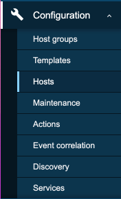
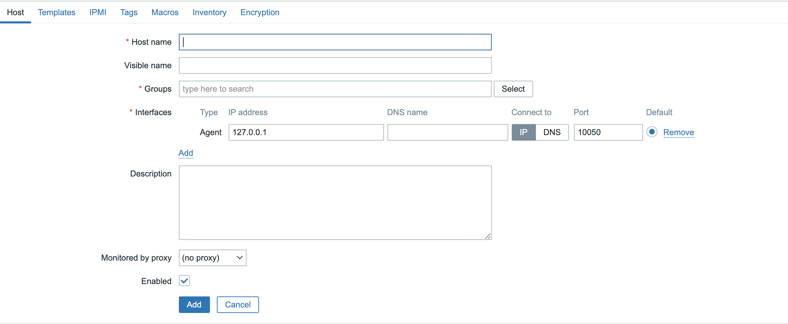
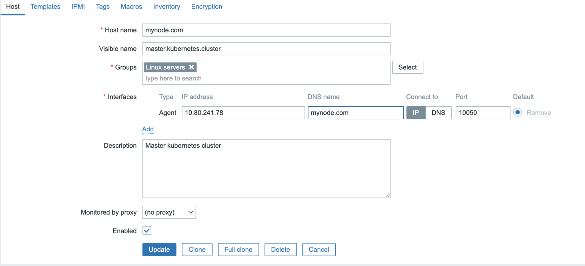
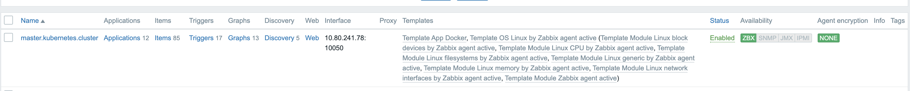

In this blog I will walk you through basic steps needed to deploy a Zabbix 5 Agent on a `Centos` Machine. The Zabbix Release is available [here](https://repo.zabbix.com/zabbix/5.4/rhel/7/x86_64/).

## Machine

```text
root@node4>cat /etc/redhat-release 
CentOS Linux release 7.9.2009 (Core)
```

Download and install the RPM

```text
rpm -Uvh https://repo.zabbix.com/zabbix/5.4/rhel/7/x86_64/zabbix-release-5.4-1.el7.noarch.rpm
```

```text
root@node4>rpm -Uvh https://repo.zabbix.com/zabbix/5.4/rhel/7/x86_64/zabbix-release-5.4-1.el7.noarch.rpm 
Retrieving https://repo.zabbix.com/zabbix/5.4/rhel/7/x86_64/zabbix-release-5.4-1.el7.noarch.rpm
warning: /var/tmp/rpm-tmp.eYow7B: Header V4 RSA/SHA512 Signature, key ID a14fe591: NOKEY
Preparing...                          ################################# [100%]
Updating / installing...
   1:zabbix-release-5.4-1.el7         ################################# [100%]
root@node4>yum install zabbix-agent
Loaded plugins: fastestmirror, langpacks, product-id, search-disabled-repos, subscription-manager

This system is not registered with an entitlement server. You can use subscription-manager to register.

Loading mirror speeds from cached hostfile
 * base: centos.excellmedia.net
 * extras: centos.excellmedia.net
 * updates: centos.mirror.snu.edu.in
base                                                                                                                                                                                                          | 3.6 kB  00:00:00     
docker-ce-stable                                                                                                                                                                                              | 3.5 kB  00:00:00     
extras                                                                                                                                                                                                        | 2.9 kB  00:00:00     
kubernetes/signature                                                                                                                                                                                          |  844 B  00:00:00     
kubernetes/signature                                                                                                                                                                                          | 1.4 kB  00:00:00 !!! 
updates                                                                                                                                                                                                       | 2.9 kB  00:00:00     
zabbix                                                                                                                                                                                                        | 2.9 kB  00:00:00     
zabbix-non-supported                                                                                                                                                                                          | 2.9 kB  00:00:00     
(1/3): updates/7/x86_64/primary_db                                                                                                                                                                            |  12 MB  00:00:01     
(2/3): zabbix-non-supported/x86_64/primary_db                                                                                                                                                                 | 3.7 kB  00:00:01     
(3/3): zabbix/x86_64/primary_db                                                                                                                                                                               |  47 kB  00:00:01     
Resolving Dependencies
--> Running transaction check
---> Package zabbix-agent.x86_64 0:5.4.7-1.el7 will be installed
--> Finished Dependency Resolution

Dependencies Resolved

=====================================================================================================================================================================================================================================
 Package                                                   Arch                                                Version                                                     Repository                                           Size
=====================================================================================================================================================================================================================================
Installing:
 zabbix-agent                                              x86_64                                              5.4.7-1.el7                                                 zabbix                                              479 k

Transaction Summary
=====================================================================================================================================================================================================================================
Install  1 Package

Total download size: 479 k
Installed size: 2.0 M
Is this ok [y/d/N]: y
Downloading packages:
warning: /var/cache/yum/x86_64/7/zabbix/packages/zabbix-agent-5.4.7-1.el7.x86_64.rpm: Header V4 RSA/SHA512 Signature, key ID a14fe591: NOKEY=                                                      ]  93 kB/s | 192 kB  00:00:03 ETA 
Public key for zabbix-agent-5.4.7-1.el7.x86_64.rpm is not installed
zabbix-agent-5.4.7-1.el7.x86_64.rpm                                                                                                                                                                           | 479 kB  00:00:02     
Retrieving key from file:///etc/pki/rpm-gpg/RPM-GPG-KEY-ZABBIX-A14FE591
Importing GPG key 0xA14FE591:
 Userid     : "Zabbix LLC <packager@zabbix.com>"
 Fingerprint: a184 8f53 52d0 22b9 471d 83d0 082a b56b a14f e591
 Package    : zabbix-release-5.4-1.el7.noarch (installed)
 From       : /etc/pki/rpm-gpg/RPM-GPG-KEY-ZABBIX-A14FE591
Is this ok [y/N]: y
Running transaction check
Running transaction test
Transaction test succeeded
Running transaction
Warning: RPMDB altered outside of yum.
Installing : zabbix-agent-5.4.7-1.el7.x86_64                                                                                                                                                                                   1/1 
  Verifying  : zabbix-agent-5.4.7-1.el7.x86_64                                                                                                                                                                                   1/1 

Installed:
  zabbix-agent.x86_64 0:5.4.7-1.el7                                                                                                                                                                                                  

Complete!
```

```text
vi /etc/zabbix/zabbix_agentd.conf
```

Update he following sections with the correct values for your Zabbix Server. In my case the server is `zabbix.server.com`

```text
ServerActive=zabbix.server.com
```

```text
Server=zabbix.server.com
```

Save and exit the configuration edit mode.

## Firewall entries

The port that it listens on is `10050` so add it to the rules

```text
firewall-cmd --zone=public --add-port=10050/tcp --permanent
```

reload the firewall

```text
firewall-cmd --reload
```

Start the agent as under and you should see output similar to what is shown below.

```text
> systemctl status zabbix-agent.service
> systemctl start zabbix-agent.service

● zabbix-agent.service - Zabbix Agent
   Loaded: loaded (/usr/lib/systemd/system/zabbix-agent.service; enabled; vendor preset: disabled)
   Active: active (running) since Tue 2021-11-09 09:01:54 UTC; 5s ago
  Process: 148585 ExecStart=/usr/sbin/zabbix_agentd -c $CONFFILE (code=exited, status=0/SUCCESS)
 Main PID: 148597 (zabbix_agentd)
    Tasks: 6
   Memory: 2.5M
   CGroup: /system.slice/zabbix-agent.service
           ├─148597 /usr/sbin/zabbix_agentd -c /etc/zabbix/zabbix_agentd.conf
           ├─148598 /usr/sbin/zabbix_agentd: collector [idle 1 sec]
           ├─148599 /usr/sbin/zabbix_agentd: listener #1 [waiting for connection]
           ├─148600 /usr/sbin/zabbix_agentd: listener #2 [waiting for connection]
           ├─148601 /usr/sbin/zabbix_agentd: listener #3 [waiting for connection]
           └─148602 /usr/sbin/zabbix_agentd: active checks #1 [idle 1 sec]
```

```text
tailf -10 /var/log/zabbix/zabbix_agentd.log
```

Your agent has been configured, now you need to go to the Zabbix Server and navigate to `Configuration -> Hosts`



Navigate to create `Host`


Fill in the values for IP, host and display name and select the template



The values for my machine are filled in like below



When you are done it will show up as below


