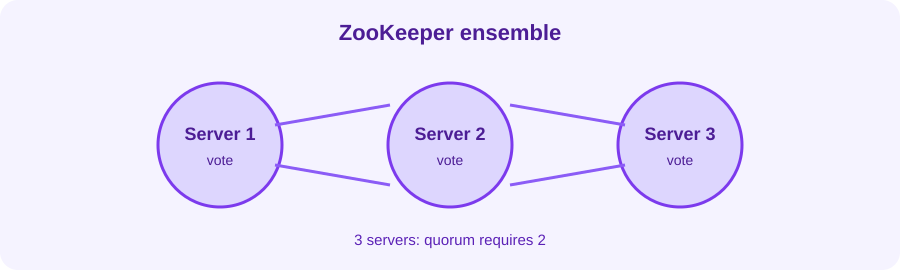

When I first came across ZooKeeper in a Kafka deployment, I treated it as another dependency that had to be started before Kafka. That explanation was not good enough. I wanted to know what it was actually doing when a broker disappeared or a controller changed.

ZooKeeper is a coordination service, not a database for application payloads. It provides a small, strongly ordered namespace where distributed systems can store metadata, discover one another, and agree on leadership.


Written up in October 2026 from my notes at the time. The ensemble state below is an illustrative example, not a current cluster capture.




## The namespace

ZooKeeper stores data in a tree of **znodes**, similar to a filesystem:

```text
/kafka
  /brokers
    /ids
    /topics
  /controller
```

A znode can contain a small value and children. ZooKeeper is designed for coordination metadata, not large messages or event storage.

## Sessions and ephemeral znodes

A client maintains a session with the ZooKeeper ensemble. If the session expires, ephemeral znodes created by that client disappear. This gives distributed systems a useful signal: a broker can register itself, and the registration disappears if the broker loses its session.

Persistent znodes remain until explicitly removed. Ephemeral znodes are tied to the client session. Sequential znodes add an increasing number, which can help create ordered contenders.

## Leader selection

Many coordination workflows use a recipe based on ephemeral sequential znodes:

1. Each participant creates an ephemeral sequential znode.
2. The participant with the lowest sequence number becomes leader.
3. Other participants watch the predecessor immediately before them.
4. If that predecessor disappears, the next participant can try again.

Watching a nearby predecessor avoids making every participant react to every change. The same principle helps reduce a thundering herd.

## Why an ensemble?

ZooKeeper is normally deployed as an odd-numbered ensemble such as three or five servers. The ensemble uses a quorum. With three servers, two must be available to make progress. With five, three are required.

More servers do not automatically mean more availability. A five-server ensemble tolerates two failures, but it also increases operational work and network dependencies. Place members across failure domains and monitor latency, disk health, and session expirations.

## ZooKeeper and Kafka

Historically, Kafka used ZooKeeper for broker registration, controller election, and cluster metadata. Kafka's newer KRaft mode moves metadata management into Kafka itself, so new deployments should choose the architecture supported by the Kafka version and operational standard they are adopting.

The important lesson remains: coordination state is different from message data. Protect it, back it up according to the product guidance, and do not treat a coordination service as a general-purpose key-value store.

Illustrative quorum check:

```text
Mode: follower
Servers in quorum: 3
Connected clients: 4
Outstanding requests: 0
```
