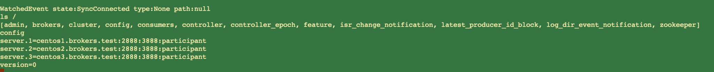


A bad way to spend one’s Friday, but at least I am ending it on a good note.
— ~ Friday guru


I was struggling with the mTLS configuration for zookeeper configuration and somehow no matter what I do I kept getting an error as below

```text
Oct 07 16:11:26 centos3.brokers.test zookeeper-server-start.sh[18171]: [2022-10-07 16:11:26,818] WARN Exception caught (org.apache.zookeeper.server.NettyServerCnxnFactory)
Oct 07 16:11:26 centos3.brokers.test zookeeper-server-start.sh[18171]: io.netty.handler.codec.DecoderException: io.netty.handler.ssl.NotSslRecordException: not an SSL/TLS record: 0000002d0000000000000000000000000000753000000000000000000000001000000000000000000000000000>
Oct 07 16:11:26 centos3.brokers.test zookeeper-server-start.sh[18171]:         at io.netty.handler.codec.ByteToMessageDecoder.callDecode(ByteToMessageDecoder.java:480)
Oct 07 16:11:26 centos3.brokers.test zookeeper-server-start.sh[18171]:         at io.netty.handler.codec.ByteToMessageDecoder.channelRead(ByteToMessageDecoder.java:279)
Oct 07 16:11:26 centos3.brokers.test zookeeper-server-start.sh[18171]:         at io.netty.channel.AbstractChannelHandlerContext.invokeChannelRead(AbstractChannelHandlerContext.java:379)
Oct 07 16:11:26 centos3.brokers.test zookeeper-server-start.sh[18171]:         at io.netty.channel.AbstractChannelHandlerContext.invokeChannelRead(AbstractChannelHandlerContext.java:365)
Oct 07 16:11:26 centos3.brokers.test zookeeper-server-start.sh[18171]:         at io.netty.channel.AbstractChannelHandlerContext.fireChannelRead(AbstractChannelHandlerContext.java:357)
Oct 07 16:11:26 centos3.brokers.test zookeeper-server-start.sh[18171]:         at io.netty.channel.DefaultChannelPipeline$HeadContext.channelRead(DefaultChannelPipeline.java:1410)
Oct 07 16:11:26 centos3.brokers.test zookeeper-server-start.sh[18171]:         at io.netty.channel.AbstractChannelHandlerContext.invokeChannelRead(AbstractChannelHandlerContext.java:379)
Oct 07 16:11:26 centos3.brokers.test zookeeper-server-start.sh[18171]:         at io.netty.channel.AbstractChannelHandlerContext.invokeChannelRead(AbstractChannelHandlerContext.java:365)
Oct 07 16:11:26 centos3.brokers.test zookeeper-server-start.sh[18171]:         at io.netty.channel.DefaultChannelPipeline.fireChannelRead(DefaultChannelPipeline.java:919)
Oct 07 16:11:26 centos3.brokers.test zookeeper-server-start.sh[18171]:         at io.netty.channel.nio.AbstractNioByteChannel$NioByteUnsafe.read(AbstractNioByteChannel.java:166)
Oct 07 16:11:26 centos3.brokers.test zookeeper-server-start.sh[18171]:         at io.netty.channel.nio.NioEventLoop.processSelectedKey(NioEventLoop.java:722)
Oct 07 16:11:26 centos3.brokers.test zookeeper-server-start.sh[18171]:         at io.netty.channel.nio.NioEventLoop.processSelectedKeysOptimized(NioEventLoop.java:658)
Oct 07 16:11:26 centos3.brokers.test zookeeper-server-start.sh[18171]:         at io.netty.channel.nio.NioEventLoop.processSelectedKeys(NioEventLoop.java:584)
Oct 07 16:11:26 centos3.brokers.test zookeeper-server-start.sh[18171]:         at io.netty.channel.nio.NioEventLoop.run(NioEventLoop.java:496)
Oct 07 16:11:26 centos3.brokers.test zookeeper-server-start.sh[18171]:         at io.netty.util.concurrent.SingleThreadEventExecutor$4.run(SingleThreadEventExecutor.java:997)
Oct 07 16:11:26 centos3.brokers.test zookeeper-server-start.sh[18171]:         at io.netty.util.internal.ThreadExecutorMap$2.run(ThreadExecutorMap.java:74)
Oct 07 16:11:26 centos3.brokers.test zookeeper-server-start.sh[18171]:         at io.netty.util.concurrent.FastThreadLocalRunnable.run(FastThreadLocalRunnable.java:30)
Oct 07 16:11:26 centos3.brokers.test zookeeper-server-start.sh[18171]:         at java.base/java.lang.Thread.run(Thread.java:829)
Oct 07 16:11:26 centos3.brokers.test zookeeper-server-start.sh[18171]: Caused by: io.netty.handler.ssl.NotSslRecordException: not an SSL/TLS record: 0000002d000000000000000000000000000075300000000000000000000000100000000000000000000000000000000000
Oct 07 16:11:26 centos3.brokers.test zookeeper-server-start.sh[18171]:         at io.netty.handler.ssl.SslHandler.decodeJdkCompatible(SslHandler.java:1215)
Oct 07 16:11:26 centos3.brokers.test zookeeper-server-start.sh[18171]:         at io.netty.handler.ssl.SslHandler.decode(SslHandler.java:1285)
Oct 07 16:11:26 centos3.brokers.test zookeeper-server-start.sh[18171]:         at io.netty.handler.codec.ByteToMessageDecoder.decodeRemovalReentryProtection(ByteToMessageDecoder.java:510)
Oct 07 16:11:26 centos3.brokers.test zookeeper-server-start.sh[18171]:         at io.netty.handler.codec.ByteToMessageDecoder.callDecode(ByteToMessageDecoder.java:449)
Oct 07 16:11:26 centos3.brokers.test zookeeper-server-start.sh[18171]:         ... 17 more
```

The error was notifying of something, but it was hard to decipher and stupid old me, I just kept overlooking at the core issue.

Thanks to not so clear apache documentation (which later I realized was all this time pointing to the issue) I kept chasing my own tail until by pure luck I tried the `zk-tls-config-file` as below

```text
ssl.clientAuth=need
zookeeper.ssl.client.enable=true
zookeeper.connect=centos3.brokers.test:2182,centos2.brokers.test:2182,centos1.brokers.test:2182
secureClientPort=2182
zookeeper.clientCnxnSocket=org.apache.zookeeper.ClientCnxnSocketNetty
zookeeper.ssl.trustStore.location=/opt/CA/netops-kafka/ssl/kafka.broker.truststore.jks
zookeeper.ssl.trustStore.password=changeit
zookeeper.ssl.keystore.location=/opt/CA/netops-kafka/ssl/kafka.broker.keystore.jks
zookeeper.ssl.keystore.password=changeit
zookeeper.set.acl=true
zookeeper.client.secure=true
```

Once I had these properties I realized the issue is that the server is getting an un-encrypted packet and hence it is throwing the error that it is.

```text
bin/zookeeper-shell.sh centos3.brokers.test:2182 -zk-tls-config-file ./config/zookeeper.config
Connecting to centos3.brokers.test:2182
Welcome to ZooKeeper!
JLine support is disabled
[2022-10-07 16:26:55,683] WARN zookeeper.ssl.trustStore.location not specified (org.apache.zookeeper.common.X509Util)

WATCHER::

WatchedEvent state:SyncConnected type:None path:null
```

BANG! she works now.


